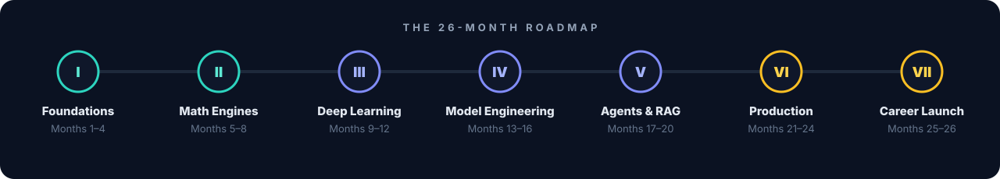
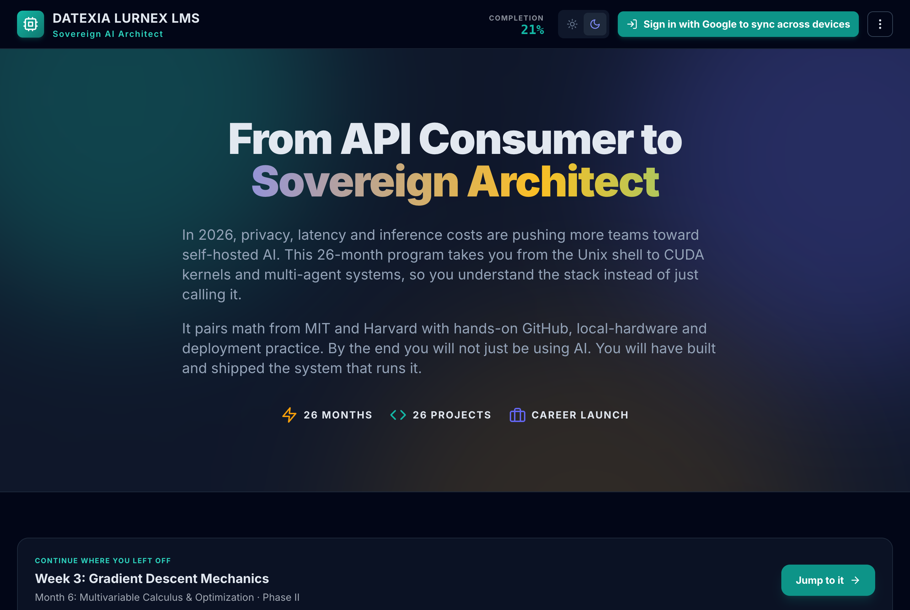
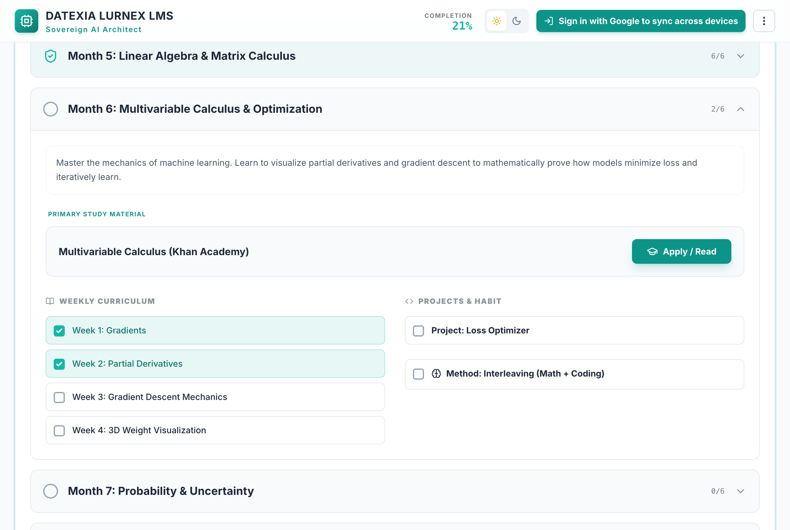
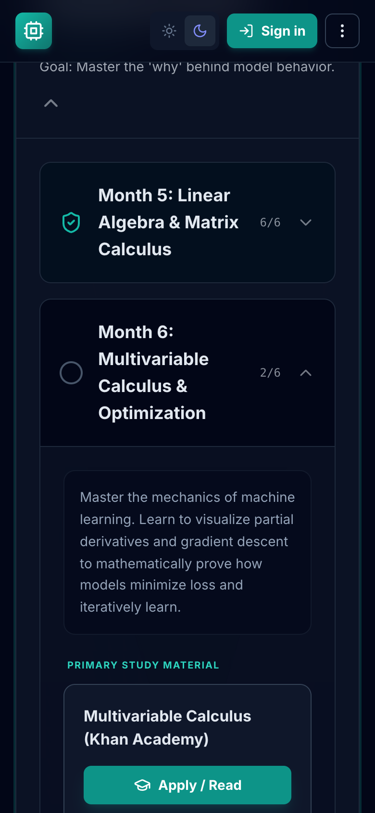

<div align="center">

<a href="https://bibeksarkar001.github.io/Datexia-Lurnex-LMS/v2/">
  
</a>

### A free, open-source learning tracker for becoming an engineer who *builds* AI infrastructure, not just calls APIs.

[](https://bibeksarkar001.github.io/Datexia-Lurnex-LMS/v2/)
[](USER_GUIDE.md)

[](https://github.com/bibeksarkar001/Datexia-Lurnex-LMS/actions/workflows/deploy.yml)
[](https://github.com/bibeksarkar001/Datexia-Lurnex-LMS/actions/workflows/link-check.yml)
[](LICENSE)


[](CONTRIBUTING.md)

</div>

---

## ✨ What is this?

**Datexia Lurnex LMS** turns a hard, two-year self-study plan into something you can actually follow, one checkbox at a time.

The plan, called the *Sovereign AI Architect Program*, goes from the Linux shell through linear algebra, PyTorch, Transformers, LoRA fine-tuning, quantization, custom CUDA kernels, RAG, multi-agent systems and desktop packaging, ending in a portfolio and a job search. Every month links to a **real, mostly free course** (MIT, Harvard, Hugging Face, NVIDIA, Microsoft Learn, Coursera audit), has **4 weekly goals**, a **hands-on project**, and a **learning-science habit** (Feynman technique, retrieval practice, interleaving…).

> **No account needed.** Open the site and start ticking boxes. Your progress is saved in your browser. Sign in with Google only if you want it synced across devices.

<p align="center">
  
</p>

## 🧭 Features

<table>
<tr>
<td width="50%" valign="top">

### 🎯 Track everything
- **158 trackable items:** 104 weekly goals, 28 project milestones and 26 learning habits.
- Live **progress ring** plus per-phase bars.
- Month badges turn green when a month is complete, with a small celebration.

</td>
<td width="50%" valign="top">

### ⚡ Pick up where you left off
- A **"Continue"** card always shows your next unchecked task.
- One click opens the right phase and month and scrolls to it.
- **Search** across months, weekly topics, projects and courses.

</td>
</tr>
<tr>
<td valign="top">

### ☁️ Guest mode + cloud sync
- Works instantly with **no sign-in** (saved to localStorage).
- Optional **Google sign-in** merges and syncs your progress through Firebase.
- **Export / import** progress as a JSON file.

</td>
<td valign="top">

### 🧑‍💻 Built to feel good
- **Dark / light** theme that follows your system and remembers your choice.
- Smooth, subtle animations, with full `prefers-reduced-motion` support.
- Keyboard and screen-reader friendly. Works from a 375 px phone up to a 4K screen.

</td>
</tr>
<tr>
<td valign="top">

### 💼 Career context
- **10 AI job roles** with indicative 2026 India salary ranges.
- A **26-project roadmap** table, filterable by difficulty from Beginner to Master.

</td>
<td valign="top">

### 🔗 Links that stay alive
- Every course link was re-verified in Nov 2026.
- A **weekly GitHub Action** checks all links and opens an issue if any break.

</td>
</tr>
</table>

## 📸 Screenshots

<p align="center">
  
</p>
<p align="center">
  
  
</p>

## 🗺️ The curriculum at a glance

| Phase | Months | You learn | Flagship project |
|:--:|:--:|---|---|
| **I** Foundations | 1–4 | Shell, web, Git, TypeScript/Node | *L5 AI Router Proxy* |
| **II** Math Engines | 5–8 | Linear algebra, calculus, probability, CI/CD | *Hallucination Scorer* |
| **III** Deep Learning | 9–12 | NumPy/Pandas, PyTorch, Transformers | *Attention Visualizer* |
| **IV** Model Engineering | 13–16 | LoRA, quantization, CUDA kernels | *The 60% Differentiator* |
| **V** Agents & RAG | 17–20 | Vector DBs, agents, memory, red-teaming | *Autonomous Developer Swarm* |
| **VI** Production | 21–24 | Ollama, Tauri, Docker/K3s | *The Cyber Factory Repo* |
| **VII** Career Launch | 25–26 | System-design interviews, job search | *Job Secured* 🎉 |

Full details, with every course and weekly topic, are in the app and in the [User Guide](USER_GUIDE.md).

## 🚀 Use it

**Online:** open **[bibeksarkar001.github.io/Datexia-Lurnex-LMS/v2](https://bibeksarkar001.github.io/Datexia-Lurnex-LMS/v2/)**. That's it.

> [!NOTE]
> **Two live versions.** `/v2/` is this redesign. The original **classic** app stays live, unchanged, at [bibeksarkar001.github.io/Datexia-Lurnex-LMS](https://bibeksarkar001.github.io/Datexia-Lurnex-LMS/). It is built from the frozen tag [`v1.0.0`](https://github.com/bibeksarkar001/Datexia-Lurnex-LMS/tree/v1.0.0). Both share the same Google sign-in and synced progress.

**Run it locally:**

```bash
git clone https://github.com/bibeksarkar001/Datexia-Lurnex-LMS.git
cd Datexia-Lurnex-LMS
npm install
npm run dev        # http://localhost:5173/Datexia-Lurnex-LMS/v2/
```

```bash
npm test           # progress-logic tests (node:test, no extra deps)
npm run build      # production build in dist/
```

<details>
<summary><b>🔧 Use your own Firebase project (optional)</b></summary>

The app works fully in guest mode without any setup. To sync with **your own** Firebase project:

1. Create a Firebase project. Enable **Authentication → Google** and **Cloud Firestore**.
2. `cp .env.example .env.local` and fill in the `VITE_FIREBASE_*` values from *Project settings → Your apps*.
3. Publish the rules from [`firestore.rules`](firestore.rules). Each user can only read and write their own document.
4. Under **Authentication → Settings → Authorized domains**, add your deploy domain.
</details>

## 🏗️ How it's built

```
src/
├── data/curriculum.js   # all course content: phases, months, links, projects, jobs
├── lib/progress.js      # pure progress logic (stats, next task, merge) + tests
├── firebase.js          # Firebase init (env-overridable)
├── components/          # UI pieces
└── App.jsx              # state, sync, layout
```

- **Content is data.** To add or replace a course, edit one file: `src/data/curriculum.js`.
- **Progress** is a flat map like `{ "m5_w2": true, "m5_p0": true, "m5_iq": true }`. It's stored in `localStorage` for guests and in `datexia-lms/{uid}` in Firestore once you sign in.
- **Deploys** happen automatically to GitHub Pages on every push to `main`.

## 🔐 Security & privacy

- The Firebase web config in the source is **public by design**. It identifies the project but [does not grant access](https://firebase.google.com/docs/projects/api-keys).
- Access is enforced by [**Firestore Security Rules**](firestore.rules): you must be signed in, and you can only touch your own progress document. Anonymous reads and writes are rejected.
- The only things stored are your checkbox state and the basic Google profile Firebase Auth provides. See [SECURITY.md](SECURITY.md).

## 🤝 Contributing

Contributions are very welcome, especially:

- 🔗 reporting or fixing a dead course link (there's an [issue template](https://github.com/bibeksarkar001/Datexia-Lurnex-LMS/issues/new?template=broken_link.yml) for it)
- 🆓 suggesting a better **free** course for any month
- 🌍 translations and ♿ accessibility improvements
- 🧪 new project ideas for any phase

Read [CONTRIBUTING.md](CONTRIBUTING.md) and the [Code of Conduct](CODE_OF_CONDUCT.md) to get started.

## 📄 License

[MIT](LICENSE) © 2026 Bibek Sarkar. Course content belongs to the respective providers. This project only links to them.

<div align="center"><sub>If this roadmap helps you, a ⭐ helps others find it.</sub></div>
